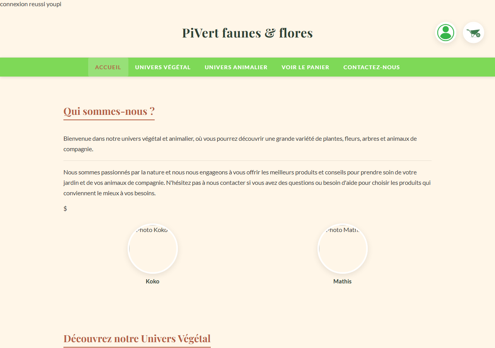
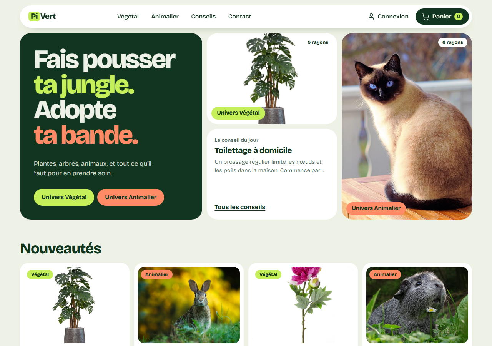
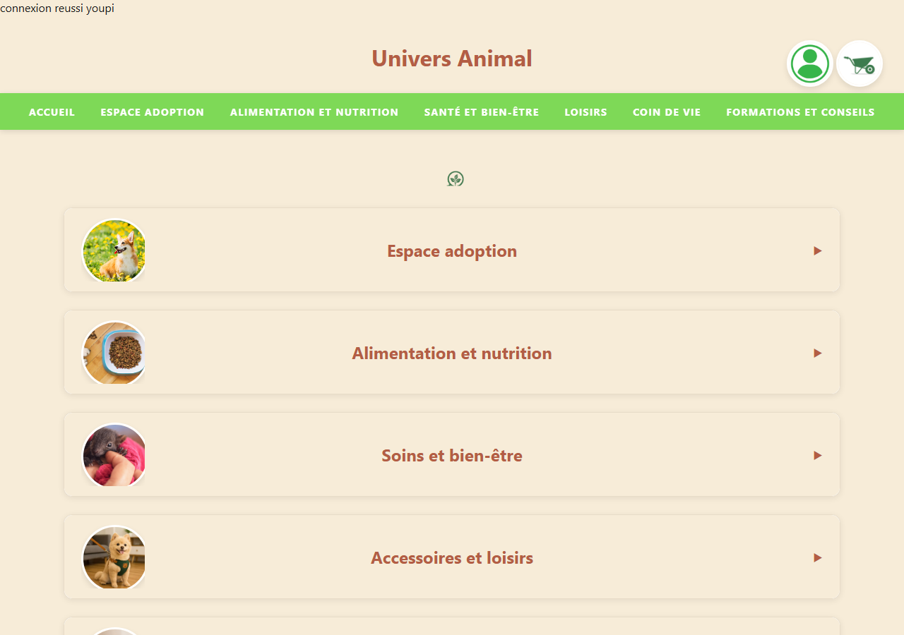
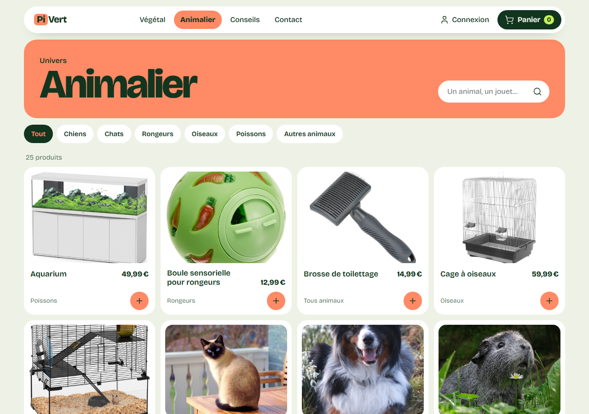
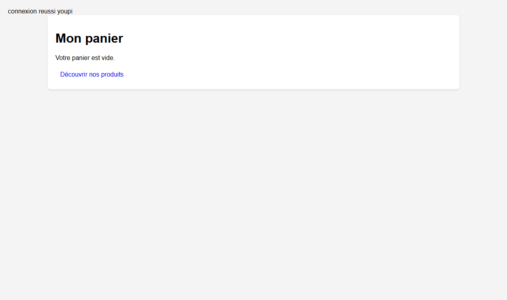
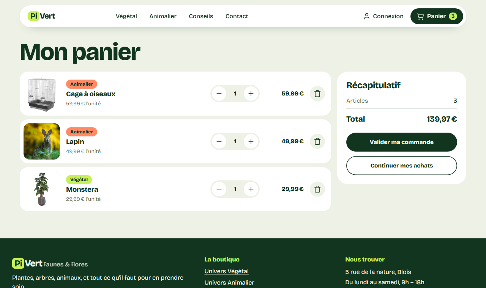

# PiVert faunes & flores

Boutique en ligne de plantes et d'animaux, avec son espace d'administration (gestion du stock et des commandes).
Ce dépôt est la **refonte complète du front et de l'admin** d'un projet étudiant : le site d'origine marchait,
mais chaque page avait son propre style, plusieurs fonctions étaient inachevées et le code avait des failles de sécurité.

| Avant | Après |
|---|---|
|  |  |
|  |  |
|  |  |

Autres captures : [pop-up produit](docs/captures/apres-popup-produit.png), [accueil sur mobile](docs/captures/apres-accueil-mobile.png),
[menu mobile](docs/captures/apres-menu-mobile.png), [admin en mode démo](docs/captures/apres-admin-demo.png).

## Ce qui a changé

- **Une identité visuelle unique** sur toutes les pages, admin comprise : base vert foncé, typo Bricolage Grotesque,
  grille « bento » sur l'accueil, et **une couleur par univers** (citron pour le Végétal, corail pour l'Animalier)
  qui colore tout ce qui appartient à l'univers : menu, bandeau, boutons, étiquettes, pop-up.
- **Un seul gabarit Twig** pour le site et l'admin : les fichiers PHP préparent les données, Twig s'occupe de l'affichage.
- **Fonctions terminées** : recherche instantanée (accents et apostrophes tolérés), filtres par catégorie ou par animal,
  caractéristiques dans la pop-up produit, panier borné au stock, validation de commande, gestion des produits avec photo.
- **Responsive** (mobile d'abord) et **accessible** : contrastes vérifiés par un test, navigation au clavier,
  pop-ups en `<dialog>` (Échap, focus gardé puis rendu), messages d'erreur reliés aux champs.
- **Sécurité** : requêtes préparées partout, mots de passe hachés (`password_hash`), jeton CSRF sur chaque formulaire,
  sorties échappées par Twig, upload d'image vérifié (type réel, taille), accès admin protégé, identifiants hors du dépôt.

## Fonctionnalités

**Boutique** : accueil, pages Univers Végétal et Univers Animalier (filtres + recherche), page Conseils, pop-up produit,
panier, inscription / connexion, validation de commande et confirmation.

**Administration** (`/admin`) : tableau de bord du stock (chiffres, stock faible, ruptures, recherche et filtre),
création / modification / suppression de produits (photo, caractéristiques, animal), commande pour un client.

**Mode démo** : un compte recruteur peut visiter toute l'administration ; chaque modification est refusée par le serveur
(bandeau « Mode démo — lecture seule » et message à chaque tentative).

## Stack

PHP 8.2 (procédural) · MySQL / MariaDB via `mysqli` · Twig 3 · HTML, CSS et JavaScript natifs (modules ES) ·
PHPUnit 11 · tests JS avec `node --test`. Pas de framework, pas de bibliothèque CSS.

## Installer en local (XAMPP)

```bash
composer install
cp config.exemple.php config.php                 # adapter les identifiants MySQL si besoin
php outils/installer-base.php                    # crée la base « pivert » (schéma + données de démo)
php outils/creer-admin.php email motdepasse prenom nom   # compte administrateur (jamais versionné)
php -S 127.0.0.1:8080 -t public                  # puis ouvrir http://127.0.0.1:8080
```

En ligne (AlwaysData par exemple), la racine web doit pointer sur `public/`.

### Comptes de démonstration

| Rôle | E-mail | Mot de passe |
|---|---|---|
| Client | `client@pivert.demo` | `demo1234` |
| Admin en lecture seule | `recruteur@pivert.demo` | `recruteur2027` |

La page de connexion propose aussi un bouton « Visiter l'admin en mode démo ».

## Choix techniques

- **Thème par univers** : `body[data-univers="vegetal|animalier"]` redéfinit la variable CSS `--accent` ;
  tous les composants utilisent `--accent`, il n'y a donc aucune règle CSS propre à un univers.
- **Pop-up produit générique** : une seule `<dialog>` par page, remplie en JavaScript à partir des données JSON
  de la carte cliquée (`data-produit`), toujours avec `textContent`. La mise en forme (prix, image, rupture)
  est une fonction pure testée (`vueProduit`).
- **Commande transactionnelle** : vérification et décrément du stock (`SELECT … FOR UPDATE` puis
  `UPDATE … WHERE quantite >= ?`), prix repris en base, puis `COMMANDE` et `COMPORTER` ; tout est annulé si un produit manque.
- **Panier en session** (`[id_produit => quantité]`), manipulé par des fonctions pures, toujours ramené au stock réel.
- **Suppression d'un produit déjà commandé** : refusée, pour garder l'historique des commandes ; il faut passer son stock à 0.
- **Amélioration progressive** : sans JavaScript, les filtres, le panier et les formulaires fonctionnent ; seuls la recherche
  instantanée et les pop-ups ont besoin de JS (le champ de recherche n'apparaît que si JS est actif).

## Organisation du code

```
public/      racine web : un fichier par page (contrôleurs minces) + assets CSS/JS + images
src/         fonctions : base, panier, commande, comptes, catalogue, validation, rendu Twig
templates/   gabarit commun, partials (nav, cartes, pop-ups…), pages, admin
sql/         schema.sql et donnees.sql
outils/      installation de la base, création du compte admin
tests/       PHPUnit (base de test « pivert_test ») et tests JS
docs/        conception, plan de réalisation, captures
```

## Tests

```bash
php vendor/bin/phpunit              # 58 tests : base, comptes, catalogue, panier, commande, admin, rendu
node --test "tests/js/*.test.js"    # 18 tests : recherche, pop-up produit, contrastes des couleurs
```

Les tests PHP recréent la base `pivert_test` à partir des scripts SQL.

### Parcours vérifié à la main (17/11/2026, 1280 px et 360 px)

- [x] Accueil → Univers Végétal : filtre, recherche « erable » (ne garde que l'Érable), message « aucun produit »
- [x] Pop-up produit : caractéristiques, quantité, ajout au panier, Échap et retour du focus sur la carte
- [x] Univers Animalier : filtre Chats (inclut les produits « tous animaux »)
- [x] Panier : −/+, retrait, quantité bornée au stock, produit supprimé ignoré, envoi sans jeton CSRF refusé
- [x] Validation non connecté → connexion → récapitulatif → confirmation ; double envoi = une seule commande
- [x] Admin anonyme ou client → refusé (sans boucle de redirection) ; mode démo : lecture OK, écritures refusées
- [x] Admin : création avec photo et caractéristiques, modification, suppression refusée si commandé, commande pour un client
- [x] Menu mobile au clavier, aucune erreur JavaScript dans la console

## Crédits

Projet d'origine : SAÉ 203 (BUT MMI 1, 2025-2026), en binôme avec Korantin Mercuzot. Refonte complète du front et de l'admin : Mathis Beaussier, 2026.

Icônes : tracés [Lucide](https://lucide.dev) (licence ISC). Photos produit : celles du projet d'origine.
